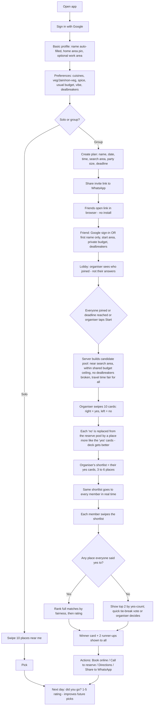

# Binged — Build Spec for Claude Code

> **How to use this file:** put it in the root of an empty project folder as `SPEC.md`. Then tell Claude Code:
> "Read SPEC.md. Build Binged milestone by milestone, starting with M0. After each milestone, run the app, check every acceptance criterion, and stop so I can review before you start the next one."

> **Decisions taken on top of this spec (2026-11-23):**
> - **Group swiping: everyone swipes the same deck of 10+ places** (answers open question 1 in favour of the fuller option). The winner comes from places everyone swiped right on; §7.3 matching applies to that deck.
> - Build on mocked Google data and a stand-in sign-in until the Supabase, Google and Vercel accounts exist.
> - Mock cards use real Bengaluru restaurant names with no invented facts (price, rating, hours and photos come from Google later).
> - "Everyone puts in an address" is met by area + map pin (§2.2); the one place that suits all is the midpoint of everyone's start points ("Anywhere fair").

---

## 1. What we are building

**Binged** helps a friend group (or a couple) in Bengaluru agree on one restaurant fast.

The organiser signs in, sets their preferences, creates a group plan and shares a link on WhatsApp. Friends open the link, add their own preferences, and everyone swipes right (yes) or left (no) on restaurant cards. Binged finds the restaurants everyone said yes to, picks the fairest one (budget, travel time, taste), and hands off to booking, a phone call, or directions.

**Target platform:** a mobile-first web app (PWA). Friends must be able to take part from a WhatsApp link **without installing anything**.

---

## 2. Key decisions and constraints (read before coding)

1. **Sign-in = "Continue with Google"** (gives name + email; no separate "type your Gmail" step). Phone OTP can be added later.
2. **Do NOT collect a full street address.** Store only the user's **home area** (locality + map pin, e.g. "Indiranagar") and an optional **work area**. This is enough for travel times and keeps us compliant with India's data protection law (DPDP Act, 2023): collect the minimum, explain why, delete on request.
3. **Budgets are private.** A member's budget is never shown to any other member or sent to any other member's browser. Only the server uses it (to compute the group's shared budget ceiling).
4. **Restaurant data comes from Google Places API (New)** — Nearby Search / Text Search with a field mask. Useful fields: `id`, `displayName`, `location`, `primaryType`, `types`, `priceLevel`, `priceRange`, `rating`, `userRatingCount`, `photos`, `currentOpeningHours`, `nationalPhoneNumber`, `googleMapsUri`, `reservable`, `servesVegetarianFood`, `servesBeer`, `servesWine`. Different fields are billed at different tiers — request only what each screen needs.
   - Respect Google's terms on storing Places content: persist `place_id`; re-fetch details when needed; keep short-lived caches only.
5. **Travel times come from Google Routes API** (`computeRouteMatrix`) with the plan's departure time, so traffic is taken into account. Batch requests; respect the matrix size limits in Google's docs.
6. **Booking: there is no public Zomato/District/Swiggy Dineout booking API to plug a key into.** Zomato's old public developer API is no longer available. So in v1, "Book" is a **hand-off**:
   - **Call** → `tel:` link with the restaurant's phone number.
   - **Directions** → Google Maps directions URL with the `place_id`.
   - **Book online** → open the restaurant's Google Maps page (`googleMapsUri`, which shows a reserve button where one exists), or the restaurant's website.
   - Build a **`BookingProvider` interface** so a real booking partner (any platform that later gives us a partner API) can be added without changing the flow (see §8).
7. **No payments, no reviews, no social feed, no delivery** in v1.

---

## 3. Tech stack

| Layer | Choice | Why |
|---|---|---|
| Frontend | Next.js (App Router) + TypeScript + Tailwind CSS | One codebase for web + PWA |
| Swipe cards | Framer Motion (drag gestures) | Smooth swipe left/right |
| Backend | Next.js Route Handlers / Server Actions | No separate server needed |
| Database + Auth + Realtime | Supabase (Postgres, Google OAuth, Realtime, Row Level Security) | Live updates when friends join and swipe |
| Maps & places | Google Places API (New), Routes API, Maps JavaScript API (location picker) | Restaurant data and real travel times |
| Hosting | Vercel | Simple deploys |
| Analytics | PostHog (or similar) | Funnel tracking (§11) |

---

## 4. End-to-end workflow



---

## 5. Screens and steps (in build order)

### S1 — Welcome & sign in
- "Continue with Google". On first sign-in, create a `users` row with `name`, `email`, `avatar_url` from Google.
- Show a one-line privacy note: "We only use your area and preferences to find fair places for your group."

### S2 — Basic profile
- Name (pre-filled, editable).
- **Home area**: search box + map pin (Places Autocomplete restricted to Bengaluru). Store `home_area_name`, `home_lat`, `home_lng`.
- Optional **work area** (same picker).
- Email is shown read-only (from Google). No street address field.

### S3 — Preferences (onboarding, 2 minutes, every question skippable)
- Cuisines liked (multi-select chips: North Indian, South Indian, Chinese, Asian, Italian, Continental, Cafe, Biryani, Desserts, …).
- Diet: Veg / Non-veg / Jain / Vegan / Eggetarian.
- Spice: Mild / Medium / Hot.
- Usual budget per person (₹ slider). Label: "Private — only you can see this."
- Vibe: Quiet / Lively / Rooftop / Cafe / Pub / Family.
- Dealbreakers: Must have veg options, No alcohol served, Needs parking, Wheelchair access, Max travel time (default 40 min).
- Save to `preferences`. Editable from a profile screen.

### S4 — Home: solo or group
- Buttons: **"Plan with friends"** (group) and **"Find something for me"** (solo).
- List of active plans.

### S5 — Create group plan
- Fields: plan name (default "Friday dinner"), date, time, **search area** ("Anywhere fair" = midpoint of members, or a picked locality), expected party size, response deadline (default 2 hours).
- Creates `plans` row with status `collecting`. The organiser becomes a `plan_members` row with role `organiser`.

### S6 — Share to WhatsApp
- Generate an invite URL: `https://<domain>/j/<invite_code>` (short random code, not guessable, expires after the plan).
- Button opens `https://wa.me/?text=<urlencoded message>`, e.g. "Join my Binged plan for Friday dinner — takes 30 seconds: <link>".
- Also a "Copy link" button.
- Link preview (Open Graph tags): plan name + date + Binged logo.

### S7 — Friend joins (web, no install)
- Opens `/j/<invite_code>`. Two options: "Continue with Google" (saves a profile for next time) **or** "Just my first name" (guest member, no account).
- 30-second form: start area at plan time (pin), private budget, dealbreakers, mood. Pre-filled from their profile if they have one.
- Creates `plan_members` row. Never show other members' budgets.

### S8 — Lobby (real time)
- Organiser sees avatars/first names of who has joined and who has finished the form — **not their answers**.
- "Start picking" button: enabled when ≥2 members have answered; auto-start at the deadline.
- Members who haven't answered by the deadline: use their saved profile if any, otherwise exclude and say so.

### S9 — Candidate pool (server, invisible to users)
See §7 for the algorithm. Output: an ordered `candidates` list of ~30 places for the plan: the first 10 are the **deck**, the rest are the **reserve**.

### S10 — Organiser swipe deck
- Full-screen cards, one at a time: photo, name, area, cuisine, price per head (₹ range), rating, **travel time for each member by first name**, and a one-line "why it fits" (e.g. "Fits everyone's budget · longest trip 24 min · veg options").
- Swipe right = yes, left = no. Also tap buttons ✓ / ✕ for accessibility, and an undo button for the last swipe.
- After every **left** swipe, replace that slot with the best-matching place from the reserve (see §7 refinement), so the deck "gets better" as they swipe.
- Ends when: organiser has **6 yes**, OR has swiped **20 cards**, OR taps "Done". Minimum shortlist = 3 yes (if fewer, prompt "Swipe a few more" and refill from the reserve).

### S11 — Group swipe (real time)
- The organiser's shortlist (3–6 places) is pushed to every member at once (Supabase Realtime).
- Each member swipes the same shortlist. Progress bar: "3 of 4 have swiped."
- Members can't see each other's swipes until results.

### S12 — Results
- When all members finish (or at the deadline):
  - **Full matches** (everyone said yes) are ranked by fairness, then rating.
  - If none: show the top 2 by yes-count with a 60-second tie-break vote; if still tied, the organiser decides.
- Show **winner** big, plus up to 2 runner-ups. Each card shows who said yes and each member's travel time.

### S13 — Winner actions
- **Book online** → `BookingProvider` (see §8). In v1: opens the place's Google Maps page or website.
- **Call to reserve** → `tel:` link.
- **Directions** → Google Maps directions to the `place_id`.
- **Share to WhatsApp** → "We're going to <name> at 8:30 pm 🎉 <maps link>".
- Day-of reminder (P1): push notification or WhatsApp share prompt 3 hours before.

### S14 — Post-visit check (next day)
- "Did you go? Yes / No / Went somewhere else" + 1–5 rating.
- Stored in `visit_ratings`; used to tune each user's preference weights.

### Solo mode (same engine, one member)
- Search area defaults to the user's current/home area; deck of 10; swipes refine; the top "yes" becomes the pick; same S13 actions.

---

## 6. Data model (Postgres / Supabase)

```sql
users (
  id uuid pk, email text unique, name text, avatar_url text,
  home_area_name text, home_lat double precision, home_lng double precision,
  work_area_name text, work_lat double precision, work_lng double precision,
  created_at timestamptz default now()
)

preferences (
  user_id uuid pk references users,
  cuisines text[], diet text, spice text,
  budget_per_person int,            -- INR, private
  vibes text[], dealbreakers text[], max_travel_min int default 40,
  updated_at timestamptz
)

plans (
  id uuid pk, organiser_id uuid references users,
  name text, starts_at timestamptz, search_mode text check (search_mode in ('anywhere_fair','area')),
  search_area_name text, search_lat double precision, search_lng double precision,
  party_size int, deadline_at timestamptz,
  status text check (status in ('collecting','organiser_swiping','group_swiping','decided','closed')),
  invite_code text unique, winner_place_id text,
  created_at timestamptz default now()
)

plan_members (
  id uuid pk, plan_id uuid references plans, user_id uuid null references users,
  display_name text, role text check (role in ('organiser','member')),
  start_lat double precision, start_lng double precision, start_area_name text,
  budget_per_person int,            -- PRIVATE: never selectable by other members (RLS)
  dealbreakers text[], mood text,
  answered_at timestamptz, swiped_done_at timestamptz
)

candidates (
  id uuid pk, plan_id uuid references plans, place_id text,
  pool text check (pool in ('deck','reserve','shortlist')),
  score numeric, fairness_max_min int, fairness_spread_min int,
  travel jsonb,                     -- { member_id: minutes }
  reason text, position int
)

swipes (
  id uuid pk, plan_id uuid, member_id uuid references plan_members,
  place_id text, stage text check (stage in ('organiser','group')),
  liked boolean, created_at timestamptz default now(),
  unique (plan_id, member_id, place_id, stage)
)

visit_ratings (
  id uuid pk, plan_id uuid, member_id uuid, went text, rating int, created_at timestamptz
)
```

**Row Level Security (must have):**
- A member can read a plan and its members' `display_name`, `answered_at`, `swiped_done_at` — **never** another member's `budget_per_person`, start location or swipes. Expose a SQL view `plan_members_public` without private columns and use only that on the client.
- Only server code (service role) reads budgets and computes candidates.
- Swipes are readable by the owner only, until the plan status is `decided`; then aggregated results (counts and who said yes) are readable by members.

---

## 7. Candidate, refinement and matching logic

### 7.1 Build the candidate pool (server)
```
inputs: members[] with start point, budget, dealbreakers, mood; plan time; search area
shared_ceiling = min(member.budget_per_person)          // never revealed
search_center  = plan.search_mode == 'area' ? plan.search_point
                 : geographic midpoint of member start points
1. Places Nearby Search around search_center (radius 3–6 km, type restaurant/cafe/bar), up to ~60 results.
2. Hard filters:
   - open at plan time (currentOpeningHours / regularOpeningHours)
   - price fits shared_ceiling (use priceRange if present, else priceLevel via a config map — tune these numbers)
   - no member dealbreaker broken (e.g. 'veg options' -> servesVegetarianFood true; 'no alcohol' -> servesBeer/servesWine false)
3. Travel: Routes API matrix, origins = member start points, destinations = remaining places, departure = plan time.
   Drop a place if ANY member's time > that member's max_travel_min.
4. Score each place (0..1 each, weights in config, equal to start):
   taste    = overlap between place cuisine/types and members' liked cuisines
   fairness = 1 - normalised(max travel minutes) blended with low spread (max - min)
   vibe     = match with members' moods
   quality  = rating weighted by userRatingCount
   novelty  = not previously visited/rated by members
5. Diversity: the first 10 (deck) must not have more than 3 of the same primary cuisine.
6. Save: top 10 -> pool 'deck', next ~20 -> pool 'reserve'. Store travel per member and a one-line reason built from the top factors.
```

### 7.2 Swipe refinement ("the deck gets better")
```
liked_profile = average features of right-swiped cards (cuisine one-hot, price, vibe tags, distance)
on left swipe:
  replacement = reserve place with highest (score * 0.5 + cosine_similarity(features, liked_profile) * 0.5)
  move it into the deck at the swiped slot; remove from reserve
if reserve empty -> fetch next page of Nearby Search and re-run 7.1 steps 2–4 for the new places
```

### 7.3 Group matching
```
shortlist = organiser's yes cards (3..6)
after everyone swipes (or deadline):
  full_matches = places with liked == true from ALL members who swiped
  if full_matches not empty:
      winner = sort(full_matches, by fairness_max_min asc, then rating desc)[0]
  else:
      top2 = places sorted by yes_count desc, then fairness
      run a 60-second tie-break vote among members; if still tied, organiser chooses
  runner_ups = next 2 by the same order
  plan.status = 'decided'; plan.winner_place_id = winner
```
Results must be **deterministic**: the same swipes always produce the same winner.

---

## 8. Booking hand-off (pluggable)

```ts
interface BookingProvider {
  id: string;                     // 'google_maps' | 'website' | 'phone' | future partner
  label: string;                  // "Book online", "Call to reserve"
  canHandle(place: PlaceDetails): boolean;
  getAction(place: PlaceDetails, opts: { partySize: number; startsAt: Date }): { type: 'url' | 'tel'; value: string };
}
```
v1 providers, in this order of preference:
1. `GoogleMapsProvider` — `place.googleMapsUri` (shows a reserve button on Google Maps where the restaurant supports it).
2. `WebsiteProvider` — `place.websiteUri`.
3. `PhoneProvider` — `tel:${place.nationalPhoneNumber}`.

Leave a clearly marked stub `PartnerBookingProvider` for a future booking partner API (keys from env vars). **Do not scrape or call undocumented endpoints of any booking platform.**

---

## 9. API routes (Next.js)

| Method & path | Does |
|---|---|
| `POST /api/plans` | Create plan (organiser) |
| `GET /api/plans/[id]` | Plan + public member list |
| `POST /api/plans/[id]/join` | Join via invite code; create plan_member |
| `POST /api/plans/[id]/answer` | Save member's start point, budget, dealbreakers, mood |
| `POST /api/plans/[id]/start` | Organiser starts; server builds candidate pool (§7.1) |
| `GET /api/plans/[id]/deck` | Current deck for the caller (organiser stage) |
| `POST /api/plans/[id]/swipe` | Record swipe; on left swipe return replacement card (§7.2) |
| `POST /api/plans/[id]/shortlist` | Organiser finishes; push shortlist to members |
| `POST /api/plans/[id]/finish` | Member finished group swipe; run matching when all done (§7.3) |
| `GET /api/plans/[id]/result` | Winner, runner-ups, yes-counts, travel times |
| `POST /api/plans/[id]/rating` | Post-visit rating |
| `POST /api/solo/deck` | Solo mode deck |

All Google API calls happen **server-side only**; the browser never sees the server API key. (The Maps JavaScript key for the location picker must be a separate, HTTP-referrer-restricted key.)

---

## 10. Non-functional requirements

- Friend join form loads in < 2 s on 4G; deck generation < 8 s; swipe response < 300 ms (preload the next 2 cards).
- Works on Chrome Android 10+ and Safari iOS 15+ at 360 px width.
- Accessibility: swipe has button alternatives; all controls labelled; text readable at 200%.
- If the Routes API fails, fall back to straight-line distance and label travel as "approx."
- Delete plan members' start points and budgets 90 days after the plan date; delete a user's data on request.
- Privacy policy + consent line on the join form.

---

## 11. Analytics events

`signed_in`, `profile_completed`, `preferences_completed`, `plan_created`, `plan_shared_whatsapp`, `invite_opened`, `member_answered` (seconds taken), `picking_started`, `card_swiped` (liked, position), `card_replaced`, `shortlist_sent`, `group_swipe_done`, `decided` (full_match true/false, minutes from share to decision), `action_clicked` (book/call/directions/share), `visit_reported`, `rating_submitted`.

Key funnel: plan shared → ≥2 members answered → decided → visit reported "yes" → organiser creates another plan within 30 days.

---

## 12. Milestones for Claude Code (build in this order)

| # | Milestone | Acceptance criteria |
|---|---|---|
| M0 | Project setup | Next.js + TS + Tailwind + Supabase client; `.env.example`; lint + typecheck pass; deploys to Vercel preview |
| M1 | Auth + profile | Google sign-in works; profile saves home area via map picker; no address field exists |
| M2 | Preferences onboarding | All questions skippable; saved and editable; budget labelled private |
| M3 | Create plan + WhatsApp share | Plan created; invite link works in a private browser; `wa.me` opens with message; OG preview shows plan name |
| M4 | Friend join + lobby (realtime) | Guest can join with first name only; organiser lobby updates live; RLS test proves member A cannot read member B's budget |
| M5 | Candidate pool | Given 3 test members, returns 10 deck + reserve; every card fits the min budget, breaks no dealbreaker, and is within every member's travel limit; unit tests for filters and scoring |
| M6 | Organiser swipe + refinement | Swipe gestures + buttons + undo; left swipe replaces card with a more similar one; shortlist of 3–6 produced |
| M7 | Group swipe + matching | Shortlist pushed live to all; results deterministic; no-full-match path and tie-break work; unit tests for §7.3 |
| M8 | Winner actions | Book online / Call / Directions / Share all open the right target on Android and iOS |
| M9 | Solo mode + post-visit rating + analytics | Solo deck works; next-day rating saved; events fire |
| M10 | Polish | Loading/empty/error states; offline-safe join form; accessibility pass; privacy policy page |

Use **seed data / mocked Google responses** for tests so tests don't spend API credits. Put all weights, price-level-to-₹ maps, radii and limits in one `config.ts`.

---

## 13. Environment variables

```
NEXT_PUBLIC_SUPABASE_URL=
NEXT_PUBLIC_SUPABASE_ANON_KEY=
SUPABASE_SERVICE_ROLE_KEY=          # server only
GOOGLE_MAPS_SERVER_KEY=             # Places API (New) + Routes API, server only
NEXT_PUBLIC_GOOGLE_MAPS_BROWSER_KEY=# Maps JS + Autocomplete, referrer-restricted
NEXT_PUBLIC_APP_URL=
POSTHOG_KEY=
```

---

## 14. Out of scope for v1

Payments or bill splitting · reviews/photos by users · social feed · delivery · large groups (8+) · team outings · cities other than Bengaluru · languages other than English · native iOS/Android apps · a real booking API (until a partner agrees).

## 15. Open questions (decide before M5)

1. ~~Should friends swipe on the organiser's shortlist only (current design, faster) or on the full deck of 10 too (fairer, slower)?~~ **Decided: everyone swipes the full deck of 10+.**
2. Default search radius around the area: 3 km or 6 km?
3. ₹ ranges for each Google `priceLevel` when `priceRange` is missing — set after checking real Bengaluru results.
4. Should the organiser see the shared budget range ("₹800–1,200 works for all") or nothing at all?
